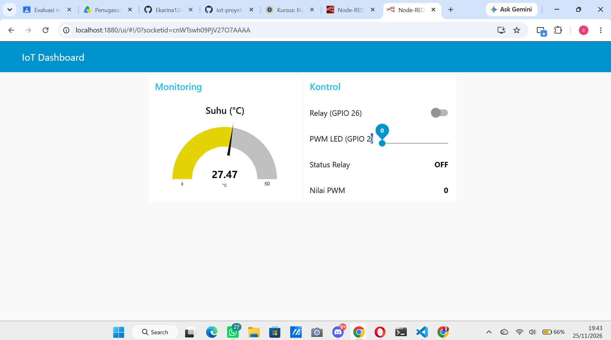
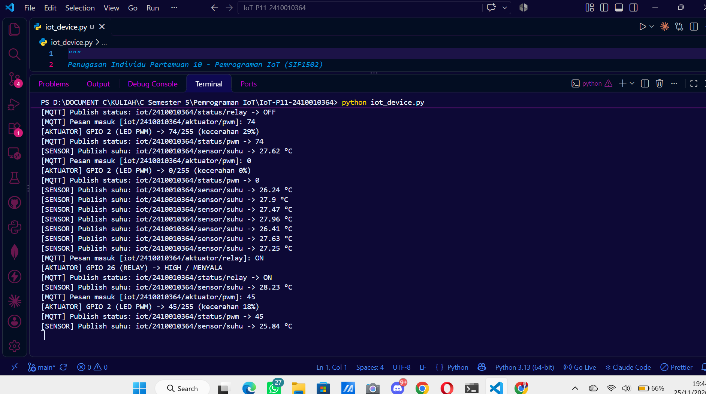
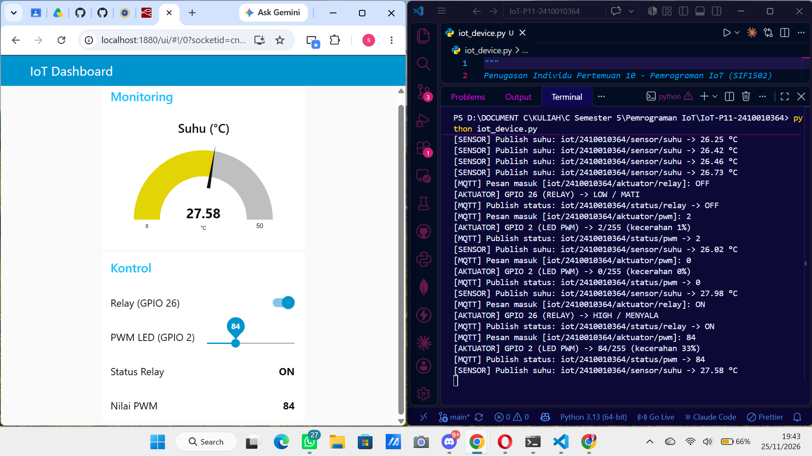

# Dashboard Node-RED untuk Kontrol Relay dan Monitoring Suhu

Penugasan Individu (Proyek Mini) Pertemuan 10 - Kontrol Jarak Jauh (Web/Mobile)
Mata kuliah Pemrograman Internet of Things (SIF1502) - UNISKA Banjarmasin
Dosen: Ahmadi, M.Kom

|      |                        |
| ---- | ---------------------- |
| Nama | Siti Ekarina Septianor |
| NIM  | 2410010364             |

## Deskripsi

Sistem IoT monitoring dan kontrol jarak jauh dengan komunikasi dua arah melalui MQTT.
Perangkat (simulasi ESP32 menggunakan Python) mengirim data suhu DHT22 ke broker, lalu
dashboard Node-RED menampilkannya pada gauge. Dari dashboard, pengguna dapat menyalakan
relay dan mengatur kecerahan LED (PWM), dan perintahnya diterima perangkat melalui broker.

## Arsitektur

```
Perangkat (Python)  <--->  Broker Mosquitto (localhost:1883)  <--->  Node-RED Dashboard
  baca suhu, relay, PWM                                                 gauge, switch, slider
```

- **Uplink (monitoring):** perangkat publish suhu setiap 3 detik, Node-RED `mqtt in` lalu `ui_gauge`.
- **Downlink (kontrol):** `ui_switch` dan `ui_slider` lalu `mqtt out`, perangkat subscribe dan menjalankan perintah.
- **Feedback:** perangkat mempublikasikan status relay dan PWM, ditampilkan pada `ui_text`.

## Isi Repo

| File                          | Keterangan                                                      |
| ----------------------------- | --------------------------------------------------------------- |
| `flow-tugas-pertemuan10.json` | Hasil ekspor flow Node-RED                                      |
| `iot_device.py`               | Kode Python (pengganti ESP32)                                   |
| `dashboard.png`               | Screenshot dashboard yang berjalan                              |
| `terminal.png`                | Screenshot terminal perangkat saat menerima perintah            |
| `dashboard-dan-terminal.png`  | Screenshot dashboard dan terminal berdampingan                  |
| `vide-demo.mp4`               | Video demo kontrol dari dashboard ke perangkat (maks. 60 detik) |
| `README.md`                   | Dokumentasi                                                     |

## Topik MQTT

| Fungsi                  | Topik                           | Arah                  | Payload                |
| ----------------------- | ------------------------------- | --------------------- | ---------------------- |
| Suhu                    | `iot/2410010364/sensor/suhu`    | Perangkat ke Node-RED | Angka (contoh `27.42`) |
| Relay                   | `iot/2410010364/aktuator/relay` | Node-RED ke perangkat | `ON` / `OFF`           |
| PWM                     | `iot/2410010364/aktuator/pwm`   | Node-RED ke perangkat | `0` - `255`            |
| Status relay (feedback) | `iot/2410010364/status/relay`   | Perangkat ke Node-RED | `ON` / `OFF`           |
| Status PWM (feedback)   | `iot/2410010364/status/pwm`     | Perangkat ke Node-RED | `0` - `255`            |

## Komponen Flow Node-RED

| Node                     | Pengaturan                                             |
| ------------------------ | ------------------------------------------------------ |
| `mqtt in`                | Topik `iot/2410010364/sensor/suhu`                     |
| `function` (Parse Float) | Mengubah payload teks menjadi angka                    |
| `ui_gauge`               | Menampilkan suhu, rentang 0 - 50 °C                    |
| `ui_switch`              | Topik relay, On Value `ON`, Off Value `OFF`            |
| `ui_slider`              | Topik PWM, rentang 0 - 255, kirim saat dilepas         |
| `mqtt out`               | Mengirim perintah ke broker (topik dari node pengirim) |
| `mqtt in` + `ui_text`    | Menampilkan status relay dan PWM dari perangkat        |

## Fitur Kode Perangkat (`iot_device.py`)

- Mengirim suhu (simulasi DHT22) setiap **3 detik**.
- Menerima perintah relay `ON`/`OFF` dan mengendalikan **GPIO 26**.
- Menerima nilai PWM dan mengatur kecerahan LED pada **GPIO 2** (nilai dibatasi 0 - 255).
- Mengirim status balik (feedback) ke dashboard.
- Reconnect otomatis ke broker.

## Cara Menjalankan

1. Jalankan Mosquitto:
   ```
   cd "C:\Program Files\Mosquitto"
   mosquitto -v
   ```
2. Jalankan Node-RED:
   ```
   node-red
   ```
   Buka `http://localhost:1880`, pasang palet `node-red-dashboard` jika belum ada.
3. Import `flow-tugas-pertemuan10.json` (Menu, Import, pilih file), lalu klik **Deploy**.
4. Pasang pustaka dan jalankan perangkat:
   ```
   pip install paho-mqtt
   python iot_device.py
   ```
5. Buka dashboard di `http://localhost:1880/ui`.

## Hasil Pengujian

Dashboard menampilkan gauge suhu, switch relay, slider PWM, dan status perangkat.



Terminal perangkat menerima perintah dari dashboard dan mengeksekusinya.



Dashboard dan terminal berdampingan:



| Pengujian                                                                      | Hasil    |
| ------------------------------------------------------------------------------ | -------- |
| Suhu tampil pada gauge dan diperbarui tiap 3 detik                             | Berhasil |
| Switch ON: terminal menampilkan `GPIO 26 (RELAY) -> HIGH`                      | Berhasil |
| Switch OFF: terminal menampilkan `GPIO 26 (RELAY) -> LOW`                      | Berhasil |
| Slider PWM 0 - 255: terminal menampilkan nilai dan persentase kecerahan GPIO 2 | Berhasil |
| Status relay dan PWM tersinkron pada dashboard                                 | Berhasil |

## Video Demo

File video: [`Video-Demo.mp4`](vide-demo.mp4) (durasi maksimal 60 detik), menampilkan kontrol
dari dashboard ke perangkat.
